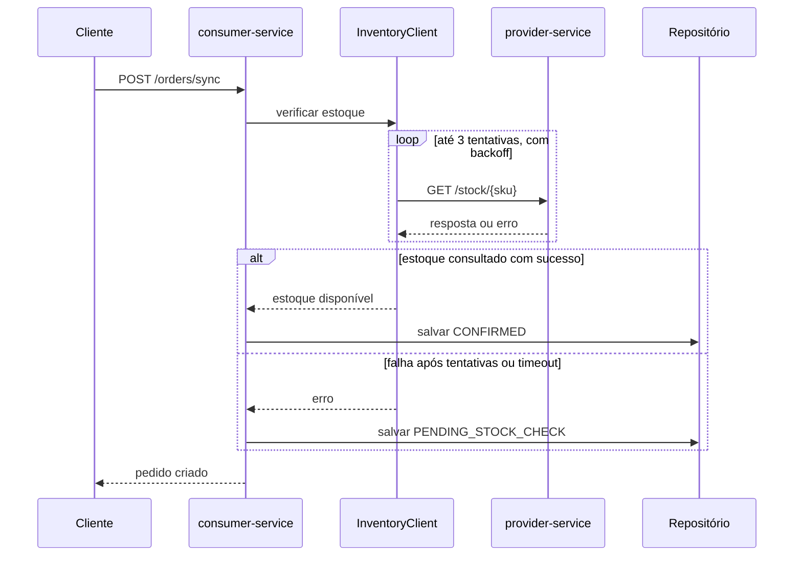
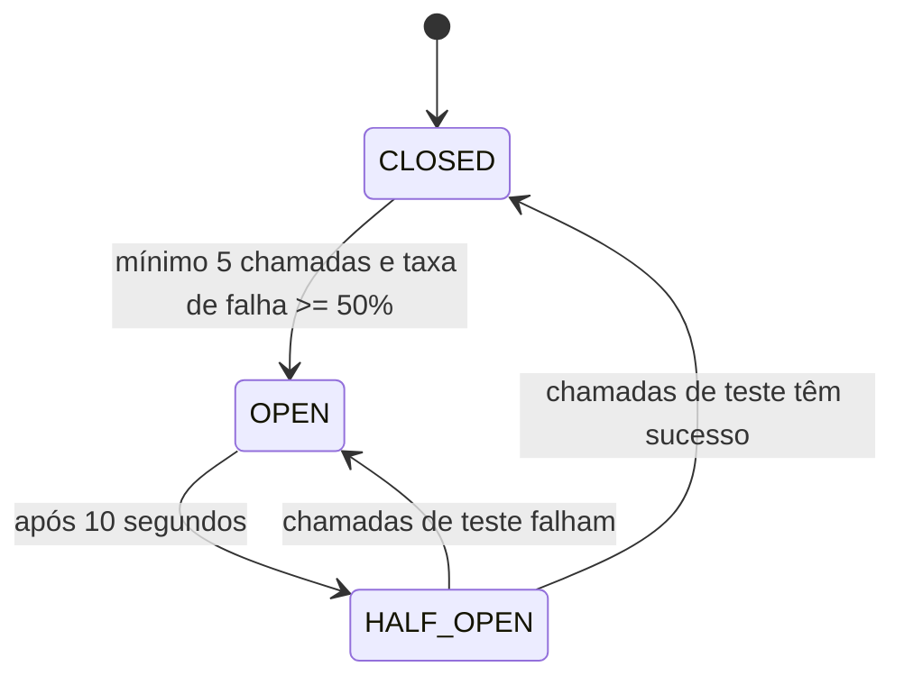
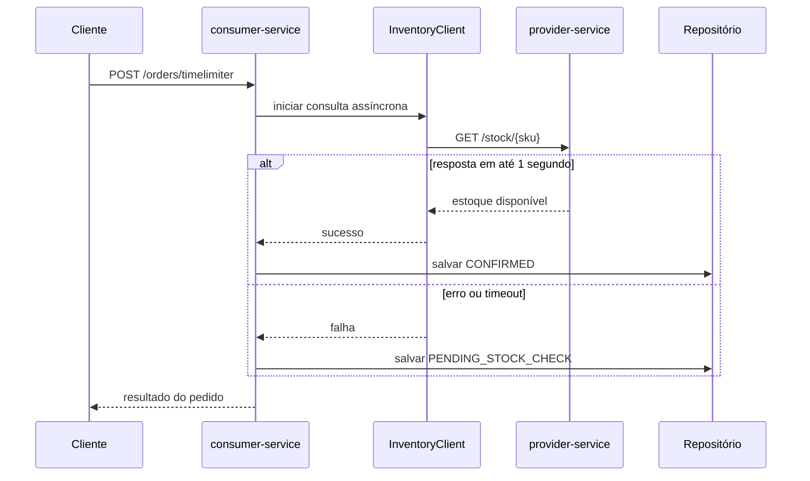

# Laboratório de resiliência

Aplicação de exemplo com dois serviços Spring Boot para demonstrar chamadas HTTP resilientes. O `consumer-service` recebe pedidos e consulta o `provider-service`, que simula um serviço de estoque instável. O projeto também demonstra retry, circuit breaker, timeout, processamento assíncrono e publicação de eventos.

## Requisitos

- Java 21
- Maven 3.6 ou superior

## Executar

Na raiz do repositório, inicie cada serviço em um terminal separado:

```bash
mvn -pl provider-service spring-boot:run
```

```bash
mvn -pl consumer-service spring-boot:run
```

O serviço de estoque fica disponível em `http://localhost:8081` e o serviço de pedidos em `http://localhost:8080`. Para compilar e executar os testes dos módulos:

```bash
mvn test
```

## Endpoints

Os endpoints de pedidos usam parâmetros de consulta `sku` e `qty` (quantidade padrão: `1`).

| Método e caminho | Descrição |
|---|---|
| `POST /orders/sync?sku=ABC&qty=1` | Cria o pedido após verificar o estoque. Em falha, aceita o pedido com status `PENDING_STOCK_CHECK`. |
| `POST /orders/async?sku=ABC&qty=1` | Retorna `202 Accepted` e permite consultar o pedido pelo ID retornado. |
| `POST /orders/timelimiter?sku=ABC&qty=1` | Executa a consulta de estoque com `TimeLimiter` e responde de forma assíncrona. Em falha ou timeout, usa `PENDING_STOCK_CHECK`. |
| `GET /orders/{id}` | Consulta o estado atual do pedido. |
| `GET /inventory/{sku}` | Faz uma chamada direta ao estoque, sem fallback, para observar falhas e o circuit breaker. |

Exemplo de criação e consulta de pedido:

```bash
curl -X POST 'http://localhost:8080/orders/sync?sku=ABC&qty=1'
curl 'http://localhost:8080/orders/ID_RETORNADO'
```

O estoque simulado responde em `GET /stock/{sku}`. Para configurar atraso ou falhas aleatórias, use `POST /chaos` no serviço de estoque:

```bash
# Atrasar as respostas em 1500 ms (acima do timeout HTTP de leitura)
curl -X POST 'http://localhost:8081/chaos?delayMs=1500&failureRate=0'

# Restaurar o comportamento normal
curl -X POST 'http://localhost:8081/chaos?delayMs=0&failureRate=0'

# Simular falha em todas as chamadas
curl -X POST 'http://localhost:8081/chaos?delayMs=0&failureRate=100'
```

`failureRate` é uma porcentagem de `0` a `100`; valores fora desse intervalo são limitados ao intervalo válido. Depois de provocar falhas no estoque, use `GET /inventory/ABC` para observar as exceções de retry e circuit breaker. O circuit breaker abre após pelo menos cinco chamadas quando a taxa de falhas atinge 50%; permanece aberto por 10 segundos antes de permitir chamadas de teste.

## Resiliência e observabilidade

O cliente de estoque do consumidor usa timeout de conexão de 500 ms e timeout de leitura de 1000 ms. No fluxo síncrono, o retry executa até três tentativas com espera inicial de 200 ms e backoff exponencial (multiplicador 2), envolto pelo circuit breaker. No fluxo com `TimeLimiter`, o limite configurado é de 1 segundo. Falhas nos fluxos de criação de pedido são degradadas para o status `PENDING_STOCK_CHECK`.

O Actuator do consumidor expõe:

- `GET /actuator/health`
- `GET /actuator/circuitbreakers`
- `GET /actuator/retries`
- `GET /actuator/metrics`

## Diagramas

### Componentes e chamadas

```mermaid
flowchart LR
    Cliente -->|POST /orders/*| Consumer["consumer-service :8080"]
    Consumer --> InventoryClient["InventoryClient"]
    InventoryClient -->|GET /stock/{sku}| Provider["provider-service :8081"]
    Consumer --> Orders[("Pedidos em memória")]
    Consumer -.->|evento de pedido| Event["OrderCreatedEvent"]
    Event -.-> Notify["Notificação assíncrona"]
    Event -.-> Billing["Faturamento assíncrono"]
```

### Pedido síncrono com retry e fallback



### Estados do circuit breaker



O estado `HALF_OPEN` permite até duas chamadas de teste. Os valores do diagrama correspondem à configuração do consumidor.

### TimeLimiter no pedido



## Testes

O teste `ResilienceTest` aponta o cliente para uma porta sem serviço, verifica o fallback do pedido e confirma que o circuit breaker abre após falhas repetidas.